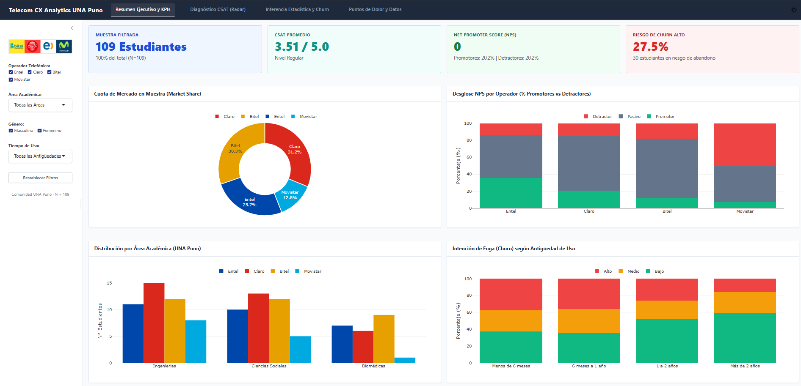
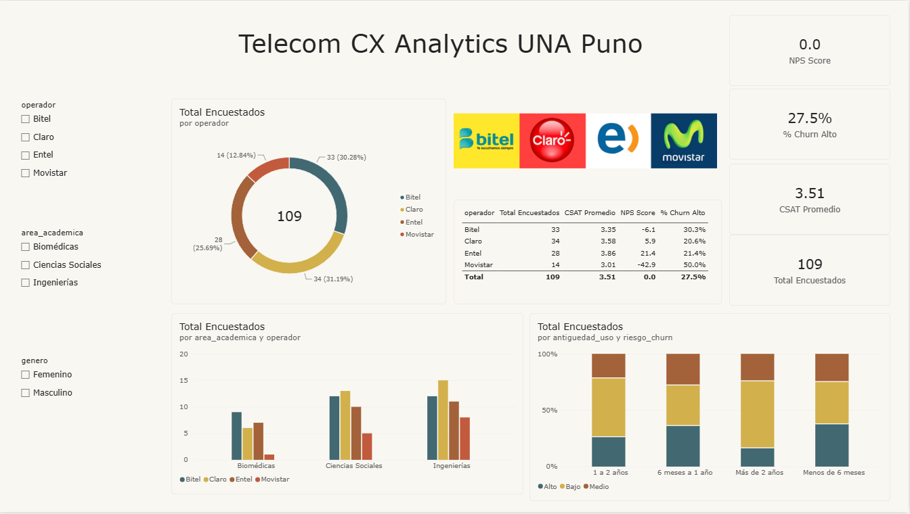

# Telecom CX Analytics: R Shiny vs. Microsoft Power BI

<div align="center">

[](https://dairdev.shinyapps.io/telecom-cx-una-puno/)
[-10b981?style=for-the-badge&logo=markdown&logoColor=white)](docs/informe_comparativo.md)
[](data/processed/dataset_curado.csv)

**Estudio Comparativo de Analitica y Visualizacion de Datos (EDA & Reporting)**  
*Universidad Nacional del Altiplano (UNA Puno) · Docente: Fred Torres Cruz *

</div>

---

## 1. Definicion del Caso: Telecom CX

* **Telecom (Telecomunicaciones):** Mercado de telefonia e internet movil en Peru (**Claro**, **Entel**, **Bitel** y **Movistar**).
* **CX (Customer Experience / Experiencia del Cliente):** Disciplina analitica que mide la calidad percibida en 5 dimensiones (cobertura, velocidad, atencion, precio, datos), la lealtad neta (**NPS**), la satisfaccion (**CSAT**) y el riesgo de fuga o migracion de operador (**Churn**).
* **Caso Aplicado:** Estudio empirico con **$N = 109$ estudiantes universitarios** de la UNA Puno (Ingenierias $42.2\%$, Ciencias Sociales $36.7\%$, Biomedicas $21.1\%$).

---

## 2. Evidencias de los Dashboards

### Modulo R Shiny (Cloud & Reactivo)
> **App desplegada en vivo:** [https://dairdev.shinyapps.io/telecom-cx-una-puno/](https://dairdev.shinyapps.io/telecom-cx-una-puno/)



### Modulo Microsoft Power BI (Desktop & Star Schema)
> **Proyecto PBIP / PBIX:** Modelado dimensional en estrella con 13 medidas DAX y filtrado cruzado nativo.



---

## 3. Modo de Ejecucion de Cada Proyecto

### A. R Shiny (Exploratory Data Analysis)
* **Modo Web (Directo):** Abre [dairdev.shinyapps.io/telecom-cx-una-puno](https://dairdev.shinyapps.io/telecom-cx-una-puno/) en cualquier navegador sin instalar dependencias.
* **Modo Local (Positron / RStudio):**
  ```r
  # 1. Instalar paquetes necesarios
  install.packages(c("shiny", "bslib", "bsicons", "plotly", "DT", "dplyr", "tidyr", "readr", "ggplot2"))
  
  # 2. Correr la app
  shiny::runApp("shiny_app")
  ```

### B. Microsoft Power BI (Business Intelligence)
* **Modo Local:** Abre [powerbi/telecom.pbip](powerbi/telecom.pbip) o [powerbi/telecom-v0.pbix](powerbi/telecom-v0.pbix) en **Power BI Desktop** (Windows).
* **Distribucion Local:** La publicacion web publica en Power BI Service requiere cuentas institucionales con licencias Pro/Fabric de pago. Por tanto, el proyecto se distribuye en formato abierto `.pbip` y `.pbix` ejecutable en cualquier equipo con Power BI Desktop.

---

## 4. Resumen Ejecutivo del Estudio ($N = 109$)

| Operador | Muestra ($n$) | Market Share | CSAT (1-5) | NPS Score | Churn Alto | Diagnostico |
| :--- | :---: | :---: | :---: | :---: | :---: | :--- |
| **Entel** | 28 | 25.7% | **3.86** | **+21.4** | 21.4% | **Lider en Satisfaccion:** Calidad superior en velocidad y senal. |
| **Claro** | 34 | **31.2%** | **3.58** | **+5.9** | 20.6% | **Lider en Cuota:** Preferencia mayoritaria y retencion solida. |
| **Bitel** | 33 | 30.3% | **3.35** | **-6.1** | 30.3% | **Economico:** Fuerte en datos/precio, penalizado en zonas rurales. |
| **Movistar** | 14 | 12.8% | **3.01** | **-42.9** | **50.0%** | **Crisis Critica:** El 50% de sus clientes planea abandonar la marca. |

* **Prueba ANOVA ($F = 4.333, p = 0.0064$):** Hay diferencias estadisticamente significativas en satisfaccion entre operadoras al 99% de confianza.
* **Correlacion Spearman ($r_s = -0.38$):** La velocidad de internet deficiente es el principal detonante de la fuga de clientes.

---

## 5. Comparativa Tecnica (Shiny vs. Power BI)

| Criterio | R Shiny (Code-First) | Microsoft Power BI (Low-Code) |
| :--- | :--- | :--- |
| **Paradigma** | Codigo puro R reactivo (`bslib` + `plotly`) | Visual drag-and-drop con motor VertiPaq |
| **Estadistica** | **Avanzada:** ANOVA, Chi-cuadrado, Spearman, Radar | Basica/Agregada: Medidas DAX |
| **Despliegue** | **Abierto y Gratuito:** shinyapps.io, Linux, Docker | Propietario (requiere licencias Pro/Premium) |
| **Modelado** | Tidyverse / scripts de transformacion | **Superior:** Esquema en Estrella visual en Power Query |
| **Filtros** | Logica reactiva programada explicita | Filtrado cruzado interactivo automatico (*Cross-filtering*) |

